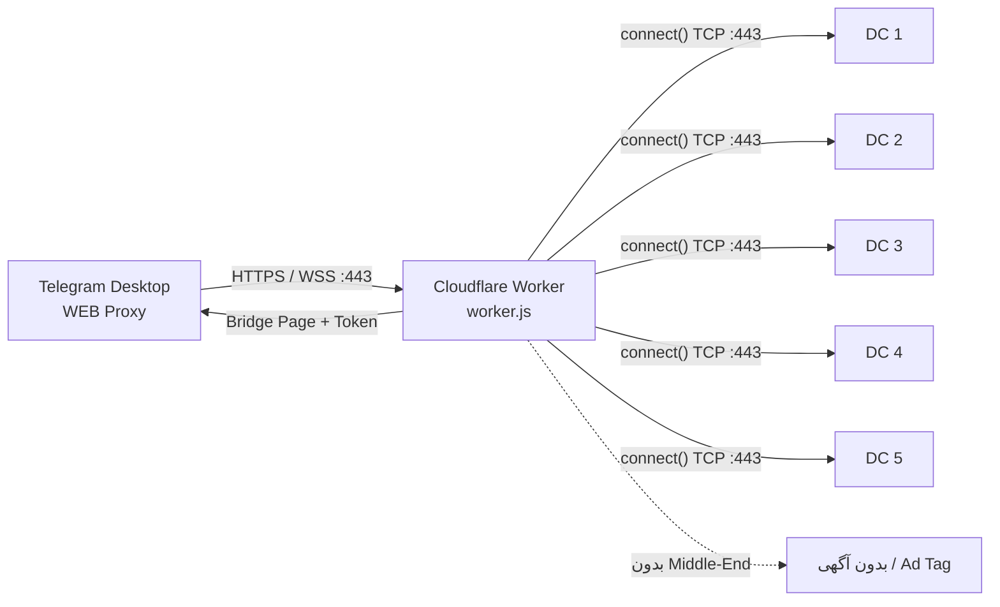
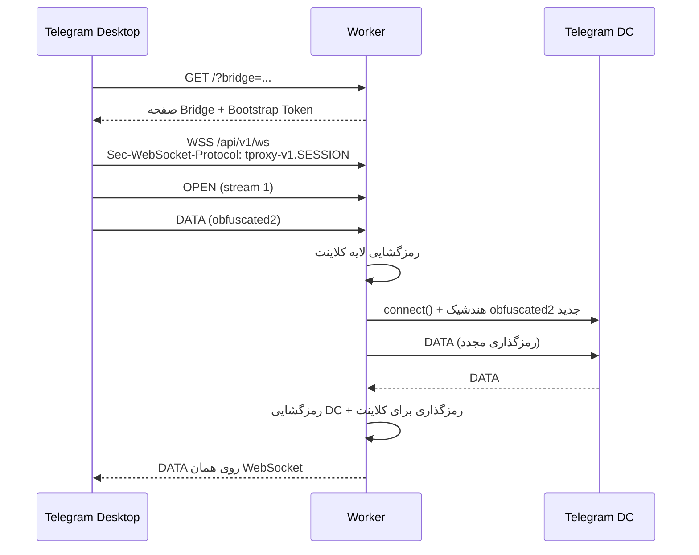

<div align="center">

# 🌐 Telegram WEB Proxy روی Cloudflare Workers

### یک فایل، یک Worker، اتصال مستقیم به دیتاسنترهای تلگرام

[](https://workers.cloudflare.com/)
[](https://developer.mozilla.org/docs/Web/JavaScript)
[](https://github.com/telegramdesktop/tproxy-server)
[](#files)

**پروکسی WEB مخصوص Telegram Desktop، بدون سرور واسط، بدون VPS و بدون بیلد**

</div>

---

> [!WARNING]
> **قبل از هر کاری این را بخوانید**
>
> استفاده از Cloudflare Workers برای ارائه‌ی VPN یا هر سرویس پروکسی مشابه، طبق **بند 2.2.1(j)** قرارداد Self-Serve Subscription Agreement کلادفلر **ممنوع** است. این پروژه صرفاً برای **آموزش، پژوهش پروتکل و استفاده‌ی شخصی/آزمایشی** ارائه شده است. خطر تعلیق حساب، بلاک شدن دامنه و از دست رفتن سرویس واقعی است. با حسابی تست کنید که از دست دادنش برایتان مهم نیست.

> [!IMPORTANT]
> این Worker یک **پروکسی WEB واقعی** است؛ یعنی خودش نقش سرور WEB را بازی می‌کند و **به هیچ پروکسی دیگری وصل نمی‌شود**. هر Stream منطقی را مستقیماً با `connect()` به IP دیتاسنتر تلگرام روی پورت 443 می‌فرستد. پروتکل لایه‌ی WEB از `tproxy-server` رسمی و لایه‌ی رمزنگاری obfuscated2 از MTProxy اقتباس شده است.

---

## 📑 فهرست مطالب

- [این پروژه چیست؟](#what)
- [یک نگاه سریع](#quick)
- [مقایسه با tproxy-server](#compare)
- [معماری](#architecture)
- [فایل‌ها](#files)
- [پیش‌نیازها](#requirements)
- [راه‌اندازی گام‌به‌گام](#install)
- [تنظیمات Worker](#config)
- [ساخت Secret با curl](#generator)
- [ساخت Secret](#secret)
- [ساخت لینک اتصال](#link)
- [تست و صحت‌سنجی](#test)
- [چرخش دامنه](#rotate)
- [پروتکل در یک نگاه](#protocol)
- [لایه‌ی رمزنگاری مستقیم](#obfuscated)
- [محدودیت‌های Cloudflare](#limits)
- [محدودیت‌های این پیاده‌سازی](#gaps)
- [امنیت و حریم خصوصی](#security)
- [عیب‌یابی](#troubleshooting)
- [سوالات متداول](#faq)
- [منابع](#refs)

---

<a id="what"></a>
## 🧭 این پروژه چیست؟

تلگرام دسکتاپ از نسخه‌های جدید، نوع پروکسی **WEB** را پشتیبانی می‌کند. در این نوع پروکسی، خود تلگرام یک «پل» (Bridge) را در یک WebView مخفی باز می‌کند و تمام اتصال‌های MTProto را از طریق یک کانال HTTPS/WSS به سرور پروکسی می‌فرستد. سرور، آن Streamهای چندگانه را از هم جدا می‌کند و هر کدام را به یک اتصال TCP به تلگرام وصل می‌کند.

این پروژه همان سرور سمت WEB است، اما:

- ✅ **تک‌فایل** است: فقط `worker.js`
- ✅ **بدون وابستگی npm** است
- ✅ روی **Cloudflare Workers** اجرا می‌شود
- ✅ از **Web Crypto** برای HMAC و AES-CTR استفاده می‌کند
- ✅ با `import { connect } from "cloudflare:sockets"` مستقیم به DC تلگرام وصل می‌شود
- ✅ اگر درخواست معتبر نباشد، یک **صفحه‌ی بی‌ضرر** نشان می‌دهد
- ❌ آگهی/Sponsored Channel ندارد (به Middle-End نیاز دارد)
- ❌ فقط Carrier نوع `websocket` را پشتیبانی می‌کند

<a id="quick"></a>
## ⚡ یک نگاه سریع

| مورد | مقدار |
|---|---|
| نوع پروژه | تک‌فایل ES Module |
| محیط اجرا | Cloudflare Workers |
| Carrier | `websocket` (یک WebSocket مالتی‌پلکس) |
| مسیر Bridge | `GET /?bridge=<capability>` |
| مسیر ساخت Secret | `GET /?create-secret=<label>` یا `GET /?--create-secret=<label>` |
| مسیر Session | `POST /api/v1/session` |
| مسیر WebSocket | `GET /api/v1/ws` |
| پورت تلگرام | همیشه `443` (خود کلاینت تحمیل می‌کند) |
| حالت Secret | `plain` و `dd` |
| ساخت Secret | دستور `curl` به خود Worker |
| تنظیمات | فقط `CONFIG` بالای `worker.js` |
| حالت اتصال | Direct DC (بدون Middle-End) |
| پلن پیشنهادی | Workers **Paid** |
| لینک | `tg://webproxy?server=<domain>&secret=<secret>` |

<a id="compare"></a>
## 🆚 مقایسه با tproxy-server

| ویژگی | tproxy-server رسمی | این Worker |
|---|---|---|
| محل اجرا | VPS / سرور اختصاصی | Cloudflare Edge |
| نصب | Caddy + MTProxy + سرویس systemd | کپی یک فایل |
| Middle-End | دارد | ندارد (Direct DC) |
| Ad Tag | پشتیبانی می‌شود | ندارد |
| Carrierها | `https`، `https-lanes`، `websocket`، `websocket-lanes` | فقط `websocket` |
| Session | پایدار در حافظه‌ی سرور | در Isolate، بدون Resume |
| Bootstrap یک‌بارمصرف | بله | خیر (تا ۱۲۰ ثانیه) |
| مناسب برای | تولید، چند کاربر، پایداری | آموزش، آزمایش، استفاده‌ی سبک |
| هزینه | هزینه‌ی VPS | Workers Paid (حداقل ۵ دلار در ماه) |

> [!NOTE]
> اگر هدف شما سرویس پایدار برای چند نفر است، `tproxy-server` رسمی انتخاب درست‌تری است. این پروژه برای کسانی است که می‌خواهند پروتکل را روی Edge بفهمند و آزمایش کنند.

<a id="architecture"></a>
## 🏗️ معماری



### جریان یک Stream



> [!NOTE]
> Worker لایه‌ی **obfuscated2** را باز می‌کند، اما محتوای داخل آن همان پیام‌های **MTProto رمزنگاری‌شده‌ی تلگرام** است. یعنی Worker کلید چت‌ها را نمی‌بیند؛ فقط طول فریم‌ها، شماره‌ی DC و زمان‌بندی را می‌بیند.

<a id="files"></a>
## 📦 فایل‌ها

| فایل | نقش |
|---|---|
| `worker.js` | تمام سرور: Bridge، Session، WebSocket، رمزنگاری و اتصال به DC |
| `README.md` | همین راهنما |

```text
proxygosha/
├── worker.js      ← تنها فایل قابل Deploy
└── README.md      ← راهنمای فارسی
```

هیچ `wrangler.toml`، `package.json`، `node_modules` یا مرحله‌ی Build لازم نیست.

<a id="requirements"></a>
## ✅ پیش‌نیازها

1. حساب Cloudflare (پلن **Workers Paid** توصیه می‌شود).
2. یک دامنه که در Cloudflare فعال است (Zone).
3. یک زیردامنه‌ی اختصاصی، مثلاً `proxy.example.com`.
4. Telegram Desktop با پشتیبانی WEB Proxy.
5. دسترسی به `curl` (برای ساخت Secret از خود Worker).

> [!TIP]
> دامنه را از قبل در Cloudflare اضافه کنید و مطمئن شوید DNS آن فعال است. برای Custom Domain، خود Cloudflare رکورد و گواهی TLS را می‌سازد.

<a id="install"></a>
## 🚀 راه‌اندازی گام‌به‌گام

### گام ۱ — ساخت Worker

1. وارد **Cloudflare Dashboard** شوید.
2. به **Workers & Pages** بروید.
3. **Create** → **Worker** را بزنید.
4. یک نام بدهید، مثلاً `tg-web-proxy`.
5. **Deploy** اولیه را انجام دهید.

### گام ۲ — قرار دادن کد

1. روی Worker ساخته‌شده **Edit code** را بزنید.
2. محتوای `worker.js` را کامل جای‌گذاری کنید.
3. `hostnames` را به دامنه‌ی خودتان تغییر دهید و برای `generatorKey` یک جمله‌ی طولانی و خصوصی بگذارید. `secretHex` را فعلاً دست نزنید:

```js
const CONFIG = {
  secretHex: "REPLACE_WITH_32_HEX_CHARS",
  hostnames: ["proxy.example.com"],
  generatorEnabled: true,
  generatorKey: "my-private-long-sentence-for-secret-generation",
  acceptGenerated: false,
  // ...
};
```

> [!CAUTION]
> جمله‌ی `generatorKey` در مثال بالا فقط نمونه است. حتماً آن را با یک جمله‌ی خصوصی و غیرقابل‌حدس عوض کنید و جایی منتشرش نکنید.

4. **Deploy** را بزنید.

> [!NOTE]
> در این مرحله خود پروکسی هنوز غیرفعال است (`secretHex` معتبر نیست)، اما **مولد Secret** کار می‌کند. این کار عمدی است تا بتوانید Secret را بدون هیچ ابزار محلی بسازید.

### گام ۳ — اتصال Custom Domain

1. وارد Worker شوید.
2. **Settings** → **Domains & Routes**.
3. **Add** → **Custom Domain**.
4. دامنه را وارد کنید، مثلاً `proxy.example.com`.
5. منتظر بمانید تا گواهی TLS صادر شود.

> [!IMPORTANT]
> تلگرام برای WEB Proxy همیشه پورت **443** و **HTTPS** را فرض می‌کند. پارامتر پورت در لینک نادیده گرفته می‌شود. پس حتماً از Custom Domain روی 443 استفاده کنید، نه `workers.dev` با مسیر عجیب.

### گام ۴ — ساخت Secret با یک دستور curl

روی همان دامنه‌ای که به Worker وصل کرده‌اید اجرا کنید:

```bash
curl -sS "https://proxy.example.com/?create-secret"
```

یا با یک برچسب دلخواه:

```bash
curl -sS "https://proxy.example.com/?create-secret=proxy.example.com"
```

خروجی چیزی شبیه این است:

```text
server=proxy.example.com
label=proxy.example.com
secret=4f8c1d2e9a7b6c5d4e3f2a1b0c9d8e7f
link=tg://webproxy?server=proxy.example.com&secret=4f8c1d2e9a7b6c5d4e3f2a1b0c9d8e7f
```

مقدار `secret=` را در `CONFIG.secretHex` بگذارید، `generatorEnabled` را `false` کنید و دوباره Deploy کنید:

```js
const CONFIG = {
  secretHex: "<SECRET_PRINTED_BY_CURL>",
  hostnames: ["proxy.example.com"],
  generatorEnabled: false,
  generatorKey: "my-private-long-sentence-for-secret-generation",
  acceptGenerated: false,
  // ...
};
```

> [!TIP]
> اگر نمی‌خواهید Secret را دستی کپی کنید، `acceptGenerated: true` بگذارید و همان لینک curl را استفاده کنید. در این حالت Worker سکرتی را می‌پذیرد که از روی هاست درخواست ساخته می‌شود. **هشدار:** هر کسی که به Worker دسترسی داشته باشد می‌تواند همین سکرت را بگیرد؛ این حالت عملاً پروکسی را برای آن هاست عمومی می‌کند. برای استفاده‌ی شخصی، حالت کپی‌کردن Secret امن‌تر است.

> [!CAUTION]
> بعد از ساخت Secret، `generatorEnabled` را `false` کنید. در غیر این صورت هر بازدیدکننده‌ای می‌تواند با همان دستور، Secret فعال شما را بگیرد.

### گام ۵ — تست سریع

```bash
curl -sS https://proxy.example.com/
```

باید یک صفحه‌ی ساده و بی‌ضرر ببینید. سپس:

```bash
curl -s -o /dev/null -w "%{http_code}\n" "https://proxy.example.com/?bridge=wrong"
```

باید `404` بگیرید.

### گام ۶ — اتصال تلگرام

از `link=` خروجی curl استفاده کنید، یا:

```text
tg://webproxy?server=proxy.example.com&secret=<SECRET>
```

تلگرام از شما می‌پرسد که پروکسی اضافه شود؛ تأیید کنید و پیام بفرستید.

<a id="config"></a>
## ⚙️ تنظیمات Worker

همه‌ی تنظیمات در بلوک `CONFIG` بالای فایل است:

| کلید | پیش‌فرض | توضیح |
|---|---|---|
| `secretHex` | `REPLACE_WITH_32_HEX_CHARS` | Secret فعال؛ ۳۲ کاراکتر hex یا `dd` + ۳۲ کاراکتر |
| `hostnames` | `["proxy.example.com"]` | دامنه‌های مجاز؛ `["*"]` برای همه |
| `generatorEnabled` | `true` | فعال بودن مسیر `?create-secret` |
| `generatorKey` | `REPLACE_WITH_LONG_RANDOM_STRING` | کلید مولد Secret؛ یک رشته‌ی طولانی و خصوصی |
| `acceptGenerated` | `false` | پذیرش Secret مشتق‌شده از هاست بدون ویرایش `secretHex` |
| `dc` | جدول DCها | نگاشت شماره‌ی DC به IP |
| `dcPort` | `443` | پورت اتصال به تلگرام |
| `carrier` | `"websocket"` | نوع Carrier |
| `batchBytes` | `2097152` | حداکثر اندازه‌ی یک Batch (۲ مگابایت) |
| `bootstrapTtl` | `120` | عمر Bootstrap Token (ثانیه) |
| `sessionTtl` | `86400` | عمر Session Token (ثانیه) |
| `maxStreams` | `32` | حداکثر Stream هم‌زمان در هر Session |
| `maxQueued` | `16777216` | حداکثر بایت صف‌شده در هر Session (۱۶ مگابایت) |
| `streamWindow` | `4194304` | پنجره‌ی اولیه‌ی هر Stream (۴ مگابایت) |
| `dataChunk` | `65536` | اندازه‌ی هر Chunk خروجی (۶۴ کیلوبایت) |

> [!IMPORTANT]
> **همه‌ی تنظیمات داخل `CONFIG` است.** این Worker هیچ متغیر محیطی، Secret Binding یا تنظیم Dashboard نمی‌خواند. فقط فایل `worker.js` را ویرایش و دوباره Deploy کنید.

> [!TIP]
> `generatorKey` را بعد از ساخت Secret عوض نکنید، وگرنه خروجی مولد تغییر می‌کند. اگر `generatorKey` را خالی بگذارید، مولد از `secretHex` استفاده می‌کند؛ در این حالت تغییر `secretHex` خروجی مولد را هم عوض می‌کند. برای پایداری، یک `generatorKey` جدا بگذارید.

### جدول DCها

| DC | IP | پورت |
|---|---|---|
| 1 | `149.154.175.50` | 443 |
| 2 | `149.154.167.51` | 443 |
| 3 | `149.154.175.100` | 443 |
| 4 | `149.154.167.91` | 443 |
| 5 | `91.108.56.156` | 443 |
| 203 | `91.105.192.110` | 443 |

> [!NOTE]
> DC 203 برای برخی حساب‌ها/مناطق استفاده می‌شود و در کد اضافه شده است. اگر IPها توسط تلگرام تغییر کنند، فقط جدول `dc` را ویرایش و دوباره Deploy کنید.

<a id="generator"></a>
## 📟 ساخت Secret با curl

برای اینکه لازم نباشد کسی `openssl` یا ابزار محلی داشته باشد، خود Worker یک مولد Secret دارد. کافی است بعد از Deploy و اتصال Custom Domain این دستور را بزنید:

```bash
curl -sS "https://proxy.example.com/?create-secret"
```

یا با برچسب دلخواه:

```bash
curl -sS "https://proxy.example.com/?create-secret=proxy.example.com"
```

### شکل دستور با فلگ

اگر دوست دارید دقیقاً شبیه فلگ بنویسید، این هم پشتیبانی می‌شود:

```bash
curl -sS "https://proxy.example.com/?--create-secret=www.google.com"
```

هر سه کلید زیر قبول می‌شوند:

| کلید | مثال |
|---|---|
| `--create-secret` | `/?--create-secret=label` |
| `create-secret` | `/?create-secret=label` |
| `create_secret` | `/?create_secret=label` |

> [!NOTE]
> `--create-secret` یک گزینه‌ی خود `curl` نیست؛ بخشی از URL است. حتماً کل URL را داخل دابل‌کوتیشن بگذارید تا PowerShell یا Bash آن را به‌عنوان فلگ جداگانه تفسیر نکند.

### خروجی

```text
server=proxy.example.com
label=proxy.example.com
secret=4f8c1d2e9a7b6c5d4e3f2a1b0c9d8e7f
link=tg://webproxy?server=proxy.example.com&secret=4f8c1d2e9a7b6c5d4e3f2a1b0c9d8e7f
```

- `server` همان هاستی است که به آن curl زده‌اید.
- `label` رشته‌ای است که Secret از روی آن ساخته شده.
- `secret` مقدار ۱۶ بایتی به‌صورت ۳۲ کاراکتر hex است.
- `link` لینک آماده برای تلگرام است.

### Secret چطور ساخته می‌شود؟

```text
key    = SHA256("tgweb-generator-v1\0" + CONFIG.generatorKey)
secret = HMAC-SHA256(key, "tgweb-secret-v1\n" + label)[0..16]
```

یعنی خروجی **قطعی** است: همان `label` و همان `generatorKey` همیشه همان Secret را می‌دهد. اگر `generatorKey` را عوض کنید، خروجی عوض می‌شود.

### فعال‌سازی Secret

دو راه دارید:

| راه | کار | امنیت |
|---|---|---|
| **کپی در `secretHex`** | مقدار `secret=` را در `CONFIG.secretHex` بگذارید، `generatorEnabled: false` کنید و Deploy کنید | بهتر |
| **`acceptGenerated: true`** | Worker سکرت مشتق‌شده از هاست درخواست را می‌پذیرد؛ نیازی به کپی نیست | ضعیف‌تر؛ مثل پروکسی عمومی |

> [!TIP]
> اگر `acceptGenerated: true` را فعال می‌کنید، از `label` برابر با همان هاست استفاده کنید یا `label` را خالی بگذارید. Worker هنگام اتصال فقط Secret مشتق‌شده از **هاست درخواست** را می‌پذیرد، نه هر برچسب دلخواه.

> [!CAUTION]
> اگر `generatorEnabled` را `true` بگذارید و Secret فعال را هم از همین مولد گرفته باشید، هر کسی می‌تواند با یک curl همان Secret را بگیرد. بعد از ساخت Secret، مولد را خاموش کنید.

### اگر Secret نمی‌خواهید بسازید

می‌توانید همان Secret تصادفی خودتان را با ابزار محلی بسازید:

```bash
openssl rand -hex 16
```

یا در PowerShell:

```powershell
-join ([System.Security.Cryptography.RandomNumberGenerator]::GetBytes(16) | ForEach-Object { $_.ToString('x2') })
```

> [!IMPORTANT]
> اگر `generatorKey` را خالی بگذارید و `acceptGenerated: false` باشد، مولد از `secretHex` به‌عنوان کلید استفاده می‌کند. در این حالت اگر `secretHex` را با خروجی مولد عوض کنید، خروجی‌های بعدی مولد تغییر می‌کنند. برای اینکه خروجی مولد ثابت بماند، یک `generatorKey` جدا و تصادفی بگذارید.

<a id="secret"></a>
## 🔐 ساخت Secret و دو حالت آن

### حالت plain

Secret یک عدد ۱۶ بایتی است که به‌صورت ۳۲ کاراکتر hex نمایش داده می‌شود:

```text
000102030405060708090a0b0c0d0e0f
```

### حالت dd

اگر Secret با `dd` شروع شود، یعنی حالت **Random Padding** فعال است:

```text
dd000102030405060708090a0b0c0d0e0f
```

در کد، هر دو حالت پشتیبانی می‌شود. برای ساخت لینک، همان مقداری را بدهید که در `CONFIG.secretHex` گذاشته‌اید. اگر `dd` بدهید، لینک هم باید `dd` داشته باشد.

> [!WARNING]
> حالت `ee` (FakeTLS) در این پیاده‌سازی پشتیبانی نمی‌شود. فقط `plain` و `dd`.

### Bridge Capability چطور ساخته می‌شود؟

کلاینت تلگرام خودش این مقدار را حساب می‌کند و در URL می‌گذارد:

```text
context = "tdesktop-web-proxy-bridge-v1\n" + host
bridge  = base64url( HMAC-SHA256(secret, context) )
```

Worker همان را با Secret خودش دوباره حساب می‌کند و مقایسه می‌کند. برای Secret نوع `dd`، بایت `0xDD` هم داخل کلید HMAC می‌رود. این طراحی از مرجع رسمی گرفته شده است.

نمونه‌ی محاسبه با Node.js (فقط برای تست محلی؛ `SECRET` را با مقدار خودتان عوض کنید):

```bash
SECRET=000102030405060708090a0b0c0d0e0f node -e "const c=require('crypto');const s=Buffer.from(process.env.SECRET,'hex');console.log(c.createHmac('sha256',s).update('tdesktop-web-proxy-bridge-v1\nproxy.example.com').digest('base64url'))"
```

> [!NOTE]
> در ویندوز PowerShell معادلش این است:
>
> ```powershell
> $env:SECRET="<YOUR_32_HEX_SECRET>"
> node -e "const c=require('crypto');const s=Buffer.from(process.env.SECRET,'hex');console.log(c.createHmac('sha256',s).update('tdesktop-web-proxy-bridge-v1\nproxy.example.com').digest('base64url'))"
> ```

<a id="link"></a>
## 🔗 ساخت لینک اتصال

### لینک استاندارد

```text
tg://webproxy?server=proxy.example.com&secret=<SECRET>
```

### لینک وب

```text
https://t.me/webproxy?server=proxy.example.com&secret=<SECRET>
```

> [!TIP]
> ساده‌ترین راه این است که از خروجی `link=` دستور مولد استفاده کنید؛ همان لینک آماده و بدون خطای تایپی است.

> [!NOTE]
> مسیر `t.me/webproxy` ممکن است در همه‌ی نسخه‌ها فعال نباشد. مطمئن‌ترین راه، همان `tg://webproxy` است که مستقیم در تلگرام باز می‌شود.

> [!CAUTION]
> هرگز Secret واقعی را در اسکرین‌شات، GitHub یا چت عمومی نگذارید.

### قوانین لینک

| قاعده | توضیح |
|---|---|
| بدون `https://` | فقط هاست، مثلاً `proxy.example.com` |
| بدون پورت | تلگرام همیشه 443 را استفاده می‌کند |
| بدون مسیر | مگر اینکه Base Path پشتیبانی شود (اینجا ندارد) |
| Secret دقیق | همان plain یا `dd` که در Worker گذاشته‌اید |
| دامنه‌ی ASCII | برای دامنه‌های بین‌المللی از فرم `xn--...` استفاده کنید |

<a id="test"></a>
## 🧪 تست و صحت‌سنجی

### ۱. تست صفحه‌ی پوششی

```bash
curl -sS https://proxy.example.com/
```

انتظار: صفحه‌ی ساده با پیام Welcome.

### ۲. تست مولد Secret

```bash
curl -sS "https://proxy.example.com/?create-secret=proxy.example.com"
```

انتظار: چهار خط `server`، `label`، `secret` و `link`. همان `label` باید همان `secret` را در دفعات بعدی بدهد.

حالت فلگ‌دار:

```bash
curl -sS "https://proxy.example.com/?--create-secret=proxy.example.com"
```

انتظار: همان خروجی. اگر `generatorEnabled` را `false` کرده باشید، پاسخ `404` است.

### ۳. تست درخواست بدون مجوز

```bash
curl -s -o /dev/null -w "%{http_code}\n" "https://proxy.example.com/?bridge=wrong"
```

انتظار: `404`.

### ۴. تست صفحه‌ی Bridge با لینک درست

مقدار Bridge را با دستور Node بالا بسازید و سپس:

```bash
curl -sS "https://proxy.example.com/?bridge=<BRIDGE>" | head -n 5
```

انتظار: کد HTML صفحه‌ی Bridge. در پاسخ باید هدرهای `Content-Security-Policy`، `Cache-Control: no-store` و `Referrer-Policy: no-referrer` باشند.

> [!CAUTION]
> این URL یک Bootstrap Token کوتاه‌عمر داخل صفحه دارد. آن را در اسکرین‌شات، Issue یا لاگ عمومی نگذارید.

### ۵. تست تلگرام دسکتاپ

1. لینک `tg://webproxy?...` را باز کنید.
2. پروکسی را فعال کنید.
3. یک پیام بفرستید و یک مدیا دانلود کنید.
4. در تنظیمات پروکسی، وضعیت اتصال را ببینید.
5. برای تست قطع، پروکسی را غیرفعال کنید؛ باید همه‌ی Streamها بسته شوند.

### ۶. چک‌لیست عیب‌یابی سریع

- [ ] دامنه روی 443 و HTTPS باز می‌شود.
- [ ] صفحه‌ی پوششی برمی‌گردد.
- [ ] مولد Secret خروجی درست می‌دهد.
- [ ] درخواست `bridge` اشتباه `404` می‌دهد.
- [ ] Secret و دامنه دقیقاً یکی هستند.
- [ ] Worker خطای CPU یا Exception نمی‌دهد.
- [ ] IP دیتاسنتر از سمت Worker قابل اتصال است.

<details>
<summary><b>وضعیت تست این نسخه</b></summary>

این نسخه قبل از تحویل، این موارد را پشت‌سر گذاشته است:

- ✅ بررسی سینتکس با `node --check`
- ✅ تطابق وکتورهای Bridge با مقادیر مرجع `PROTOCOL.md` برای Secretهای `plain` و `dd`
- ✅ تست صفحه‌ی پوششی، `404` برای Bridge اشتباه و ساخت Session با `HELLO/WELCOME`
- ✅ تست `DELETE /api/v1/session`
- ✅ تست مولد Secret با هر سه کلید `--create-secret`، `create-secret` و `create_secret`
- ✅ تست حالت `acceptGenerated` و انتقال حالت مشتق‌شده در Token
- ✅ تست End-to-End مسیر WebSocket با یک DC شبیه‌سازی‌شده: هندشیک، رمزگشایی، رمزگذاری مجدد، `WINDOW`، `DATA` دوطرفه و `CLOSE`

**آنچه هنوز باید واقعی تست شود:** اتصال `connect()` به IP واقعی تلگرام و اتصال Telegram Desktop. این دو مورد به شبکه و حساب Cloudflare شما وابسته‌اند و با شبیه‌ساز قابل اثبات نیستند.

</details>

<a id="rotate"></a>
## 🔄 چرخش دامنه

اگر یک دامنه بلاک شد یا می‌خواهید بین چند دامنه بچرخید:

1. یک Custom Domain جدید به همان Worker اضافه کنید، مثلاً `proxy2.example.com`.
2. آن را به لیست `hostnames` اضافه کنید.
3. Deploy کنید.
4. اگر از Secret ثابت استفاده می‌کنید، همان Secret قبلی کار می‌کند:

```text
tg://webproxy?server=proxy2.example.com&secret=<same-secret>
```

اگر از Secret مشتق‌شده استفاده می‌کنید، روی دامنه‌ی جدید دوباره مولد را اجرا کنید (اگر `generatorEnabled` را خاموش کرده‌اید، موقتاً روشنش کنید):

```bash
curl -sS "https://proxy2.example.com/?create-secret"
```

یا `acceptGenerated: true` را فعال نگه دارید تا Secret جدید خودکار پذیرفته شود.

5. لینک قبلی را تا زمانی که کاربران مهاجرت کنند نگه دارید.

> [!TIP]
> می‌توانید `hostnames` را `["*"]` بگذارید تا هر دامنه‌ای که به Worker وصل است کار کند. اما این کار کنترل شما را کم می‌کند و توصیه نمی‌شود. لیست صریح امن‌تر است.

### تغییر Secret

اگر Secret را عوض کنید:

- همه‌ی لینک‌های قبلی از کار می‌افتند.
- Tokenهای قبلی معتبر نیستند.
- Sessionهای باز تا بسته شدن Socket ممکن است ادامه پیدا کنند، اما اتصال جدید ساخته نمی‌شود.

<a id="protocol"></a>
## 📡 پروتکل در یک نگاه

### Endpointها

| متد | مسیر | کار |
|---|---|---|
| `GET` | `/` | صفحه‌ی پوششی |
| `GET` | `/?create-secret[=<label>]` | ساخت Secret + لینک |
| `GET` | `/?bridge=<cap>` | صفحه‌ی Bridge (فقط با Capability معتبر) |
| `POST` | `/api/v1/session` | ساخت Session با Bootstrap Token |
| `DELETE` | `/api/v1/session` | بستن Session |
| `GET` | `/api/v1/ws` | ارتقا به WebSocket |

### هدرها

```http
Authorization: Bearer <bootstrap-or-session>
Content-Type: application/octet-stream
X-Session-Token: <session>
X-Down-Cursor: 0
X-Carrier-Mode: websocket
Sec-WebSocket-Protocol: tproxy-v1.<session>
```

### فریم‌ها

هر فریم ۸ بایت هدر دارد:

```text
type:u8 | stream_id:u24 | payload_length:u32 | payload
```

| نوع | کد | جهت | توضیح |
|---|---:|---|---|
| `OPEN` | `0x01` | کلاینت → سرور | ساخت Stream جدید |
| `DATA` | `0x02` | دوطرفه | داده‌ی obfuscated2 |
| `CLOSE` | `0x03` | دوطرفه | بستن Stream |
| `WINDOW` | `0x04` | دوطرفه | اعتبار Backpressure |
| `PING` | `0x05` | سرور → کلاینت | در این پیاده‌سازی استفاده نمی‌شود |
| `PONG` | `0x06` | کلاینت → سرور | پاسخ PING |
| `HELLO` | `0x10` | کلاینت → سرور | بدنه: `0x01` |
| `WELCOME` | `0x11` | سرور → کلاینت | خوش‌آمد |
| `BYE` | `0x1f` | سرور → کلاینت | در این پیاده‌سازی استفاده نمی‌شود |

### نمونه‌ی ساخت Session

```http
POST /api/v1/session
Authorization: Bearer <bootstrap>
Content-Type: application/octet-stream

<9 bytes: 10 00 00 00 00 00 00 01 01>
```

پاسخ:

```http
200 OK
X-Session-Token: <session>
X-Down-Cursor: 0
X-Carrier-Mode: websocket
Content-Type: application/octet-stream

<8 bytes: 11 00 00 00 00 00 00 00>
```

<a id="obfuscated"></a>
## 🔒 لایه‌ی رمزنگاری مستقیم

هر Stream در Worker به‌صورت زیر عمل می‌کند:

```text
کلاینت ──obfuscated2──> Worker ──obfuscated2 جدید──> DC
کلاینت <─obfuscated2─── Worker <─obfuscated2 جدید─── DC
```

### کلیدهای سمت کلاینت

از ۶۴ بایت اول Stream:

```text
read_key  = SHA256(header[8..40]  || secret)
read_iv   = header[40..56]
write_key = SHA256(reverse(header[8..56])[0..32] || secret)
write_iv  = reverse(header[8..56])[32..48]
```

### محل Tag و DC

```text
header[56..60] = tag    (dddddddd / eeeeeeee / efefefef)
header[60..62] = dc_id  (int16 little-endian)
```

### هندشیک به DC

Worker یک هدر ۶۴ بایتی جدید می‌سازد:

- ۸ بایت اول: تصادفی، با پرهیز از پیشوندهای ممنوع (`GET `، `POST`، `HEAD`، `0xEF`، `0xEEEEEEEE`، …)
- بایت‌های `8..56`: همان بایت‌های هدر کلاینت
- بایت‌های `56..60`: همان Tag
- بایت‌های `60..62`: همان DC
- ۸ بایت آخر با کلید Write مربوط به DC و در موقعیت ۵۶ رمز می‌شود

سپس داده‌ها:

1. با کلید کلاینت رمزگشایی می‌شوند.
2. با کلید DC رمزگذاری می‌شوند.
3. پاسخ DC برعکس: رمزگشایی با کلید DC، رمزگذاری با کلید کلاینت.

> [!NOTE]
> همه‌ی AESها از نوع **AES-256-CTR** و از طریق `crypto.subtle` انجام می‌شوند. شمارنده با جمع ۱۲۸ بیتی روی IV جابه‌جا می‌شود تا Position هر Stream دقیق باشد.

<a id="limits"></a>
## 📊 محدودیت‌های Cloudflare

| محدودیت | Free | Paid |
|---|---|---|
| درخواست | ۱۰۰٬۰۰۰ در روز | بدون سقف روزانه (۱۰M در ماه شامل) |
| CPU هر درخواست | **۱۰ میلی‌ثانیه** | ۳۰ ثانیه پیش‌فرض، تا ۵ دقیقه |
| حافظه | ۱۲۸ مگابایت | ۱۲۸ مگابایت |
| Subrequest | ۵۰ | ۱۰٬۰۰۰ |
| اتصال خروجی هم‌زمان در حال انتظار هدر | ۶ | ۶ |
| حجم پیام WebSocket | ۳۲ مگابایت | ۳۲ مگابایت |
| متغیر محیطی | ۶۴ | ۱۲۸ |
| اندازه‌ی Worker | ۶۴ مگابایت | ۶۴ مگابایت |

### این اعداد در عمل چه معنایی دارند؟

- **CPU 10ms در Free**: با رمزنگاری دوطرفه‌ی هر Chunk، عملاً کافی نیست. **Paid** واقع‌بینانه است.
- **۶ اتصال هم‌زمان در حال هندشیک**: اگر تلگرام چند Stream را هم‌زمان باز کند، درخواست‌های اضافی صف می‌شوند؛ خود API محدودیت را می‌پذیرد، اما تأخیر دارد.
- **مدت اتصال HTTP/WS**: سقف سخت ندارد، اما آپدیت روتین Runtime می‌تواند اتصال‌ها را تا حداکثر ۲۰ دقیقه ببندد. کلاینت باید دوباره وصل شود.
- **پورت ۲۵ و IPهای خصوصی/Cloudflare**: مسدود هستند. DCهای تلگرام عمومی و روی 443 هستند، پس مشکل نیستند.
- **Subrequest**: هر `connect()` یک اتصال است، نه Fetch؛ محدودیت ۶ اتصال هم‌زمان فقط تا زمان دریافت هدر اولیه اعمال می‌شود.

> [!IMPORTANT]
> Workers می‌تواند به IPهای عمومی تلگرام روی 443 وصل شود، اما تلگرام ممکن است بازه‌های خروجی Cloudflare را محدود یا بلاک کند. این را فقط با تست واقعی می‌توان فهمید.

<a id="gaps"></a>
## 🧱 محدودیت‌های این پیاده‌سازی

| مورد | وضعیت |
|---|---|
| Carrier `websocket` | ✅ پشتیبانی |
| Carrier `https` | ❌ |
| Carrier `https-lanes` | ❌ |
| Carrier `websocket-lanes` | ❌ |
| Secret `plain` | ✅ |
| Secret `dd` | ✅ |
| Secret `ee` (FakeTLS) | ❌ |
| Ad Tag / Sponsored Channel | ❌ (نیازمند Middle-End) |
| Session پایدار | ❌ (در حافظه‌ی Isolate) |
| Resume بعد از قطع | ❌ |
| یک WebSocket به ازای هر Session | ❌ (توکن فقط اصالت را ثابت می‌کند) |
| Bootstrap یک‌بارمصرف | ❌ (تا ۱۲۰ ثانیه قابل استفاده است) |
| ذخیره‌ی Replay | ❌ |
| Rate Limit داخلی | ❌ (از WAF استفاده کنید) |

### چرا Ad Tag نداریم؟

آگهی/کانال اسپانسر در MTProxy از طریق **Middle-End** و پروتکل مخصوص آن منتقل می‌شود. این Worker مسیر **Direct DC** را می‌رود و Middle-End ندارد؛ پس هیچ Ad Tagای نمی‌تواند الصاق کند. این محدودیت ذاتیِ حالت Direct است، نه باگ.

### چرا Session پایدار نیست؟

Cloudflare Workers یک محیط Stateless است. Session در حافظه‌ی همان Isolate زندگی می‌کند. با Restart، Eviction یا آپدیت Runtime، Session از بین می‌رود. برای پایداری واقعی باید از Durable Objects یا Storage استفاده کنید که این پروژه عمداً تک‌فایل و بدون وابستگی نگه داشته شده است.

<a id="security"></a>
## 🛡️ امنیت و حریم خصوصی

### کارهایی که انجام می‌شود

- مقایسه‌ی HMAC و Token با `crypto.subtle.verify` (مقایسه‌ی زمان‌ثابت).
- Secret و Tokenها لاگ نمی‌شوند.
- مولد Secret فقط یک محاسبه‌ی HMAC است و خود Secret فعال را افشا نمی‌کند.
- به‌صورت پیش‌فرض مولد خروجی را «فعال» نمی‌کند؛ باید Secret را در `secretHex` بگذارید.
- درخواست‌های ناشناس صفحه‌ی بی‌ضرر می‌گیرند.
- مسیرهای API با متد و هدر اشتباه `404` می‌گیرند.
- محدودیت طول بدنه و تعداد فریم‌ها برای جلوگیری از سوءاستفاده.
- Tombstone برای Streamهای بسته‌شده و جلوگیری از Reuse.
- Backpressure با `WINDOW` و سقف صف.

### کارهایی که انجام **نمی‌شود**

- رمزنگاری سرتاسری اضافه نمی‌کند؛ همان MTProto تلگرام است.
- مانع دیدن متادیتا توسط Cloudflare نمی‌شود.
- جلوی Abuse توسط دیگران را با Rate Limit نمی‌گیرد.
- Secret را از دسترسی ادمین حساب Cloudflare پنهان نمی‌کند.

> [!CAUTION]
> هرگز Access Log را برای URL، Query، هدر `Authorization` یا `Sec-WebSocket-Protocol` فعال نکنید. در این پروژه، Capability در Query و Session Token در Subprotocol قرار دارد.

### پیشنهادهای سخت‌سازی

1. `generatorEnabled` را بعد از ساخت Secret روی `false` بگذارید.
2. `generatorKey` را یک رشته‌ی طولانی و خصوصی نگه دارید و آن را در جای عمومی نگذارید.
3. `acceptGenerated` را فقط وقتی `true` کنید که پروکسی عمومی برای آن هاست می‌خواهید.
4. `hostnames` را صریح نگه دارید، نه `*`.
5. روی `/api/v1/*` یک Rate Limit در WAF بگذارید (با احتیاط، چون WebSocket هم از این مسیر است).
6. لاگ‌های حساس را غیرفعال کنید.
7. از یک حساب/دامنه‌ی جدا برای آزمایش استفاده کنید.

<a id="troubleshooting"></a>
## 🧰 عیب‌یابی

<details>
<summary><b>صفحه‌ی پوششی می‌آید، اما Bridge باز نمی‌شود</b></summary>

- Secret در Worker با Secret در لینک یکی نیست.
- اگر Secret را از مولد گرفته‌اید، حتماً آن را در `CONFIG.secretHex` گذاشته‌اید یا `acceptGenerated: true` است.
- دامنه در `hostnames` نیست.
- Query بیش از یک پارامتر دارد یا پارامتر تکراری است.
- Capability به‌درستی Encode نشده است.

</details>

<details>
<summary><b>مولد Secret خروجی می‌دهد، اما لینک کار نمی‌کند</b></summary>

- Secret خروجی را در `secretHex` نگذاشته‌اید و `acceptGenerated` هم `false` است.
- Secret را روی یک دامنه ساخته‌اید و لینک را روی دامنه‌ی دیگر استفاده می‌کنید؛ `server=` باید همان هاستی باشد که به آن curl زده‌اید.
- `hostnames` آن دامنه را ندارد.
- `generatorKey` را بین ساخت Secret و Deploy عوض کرده‌اید.

</details>

<details>
<summary><b>مولد Secret پاسخ 404 می‌دهد</b></summary>

- `generatorEnabled` روی `false` است.
- `generatorKey` خالی است و `secretHex` هم معتبر نیست.
- مسیر را اشتباه نوشته‌اید؛ باید `/?create-secret` باشد، نه `/create-secret`.

</details>

<details>
<summary><b>تلگرام روی «Connecting» می‌ماند</b></summary>

- WebView تلگرام نتوانسته صفحه‌ی Bridge را باز کند (فایروال/ISP).
- `connect()` به DC خطا می‌دهد (بلاک شدن خروجی Cloudflare).
- CSP یا Frame-ancestors مشکل دارد.
- Worker در لاگ‌ها Exception می‌دهد.

</details>

<details>
<summary><b>خطای 1102 (CPU Exceeded)</b></summary>

- پلن Free با ۱۰ms کافی نیست.
- به Paid ارتقا دهید.
- `maxStreams` را کم کنید.
- تعداد Streamهای هم‌زمان را پایین بیاورید.

</details>

<details>
<summary><b>خطای 1101 (Exception)</b></summary>

- معمولاً `connect()` رد شده یا Socket ناگهانی بسته شده است.
- IP دیتاسنتر را بررسی کنید.
- مطمئن شوید پورت 443 و IP عمومی است.
- لاگ Worker را بدون چاپ Secret بررسی کنید.

</details>

<details>
<summary><b>بعد از چند دقیقه قطع می‌شود</b></summary>

- آپدیت Runtime کلادفلر اتصال‌ها را می‌بندد.
- Isolate ممکن است Evict شود.
- این پیاده‌سازی Resume ندارد؛ کلاینت باید دوباره Session بسازد.

</details>

<details>
<summary><b>فقط برخی DCها کار می‌کنند</b></summary>

- IPهای جدول را به‌روز کنید.
- DC 203 را برای حساب‌های خاص در نظر بگیرید.
- تست کنید کدام DC از سمت Worker قابل دسترسی است.

</details>

<a id="faq"></a>
## ❓ سوالات متداول

<details>
<summary><b>آیا روی پلن Free کار می‌کند؟</b></summary>

به‌احتمال زیاد نه. ۱۰ میلی‌ثانیه CPU برای رمزنگاری دوطرفه‌ی مداوم بسیار کم است. Paid حداقل واقع‌بینانه است.
</details>

<details>
<summary><b>آیا می‌توانند چند نفر از یک Worker استفاده کنند؟</b></summary>

بله، تا زمانی که Secret را داشته باشند. اما محدودیت Stream و منابع را در نظر بگیرید. برای چند کاربر، Secret و دامنه‌ی جدا بهتر است.
</details>

<details>
<summary><b>آیا ترافیک برای Cloudflare قابل خواندن است؟</b></summary>

Cloudflare متادیتا را می‌بیند. Worker لایه‌ی obfuscated2 را باز می‌کند، اما محتوای MTProto همچنان رمزنگاری‌شده است. با این حال، به Cloudflare به‌عنوان یک واسطه اعتماد می‌کنید.
</details>

<details>
<summary><b>چرا آگهی نمایش داده نمی‌شود؟</b></summary>

چون Ad Tag نیاز به Middle-End دارد و این Worker مسیر Direct DC را استفاده می‌کند.
</details>

<details>
<summary><b>آیا از `workers.dev` هم می‌شود استفاده کرد؟</b></summary>

ممکن است، اما برای پایداری و TLS بهتر و عبور از فیلترها، Custom Domain توصیه می‌شود. تلگرام پورت 443 را ثابت فرض می‌کند.
</details>

<details>
<summary><b>آیا می‌توانم Secret را عوض کنم بدون قطعی؟</b></summary>

نه. با تغییر Secret همه‌ی لینک‌ها و Tokenها باطل می‌شوند. برای چرخش بدون قطعی، دامنه‌ی جدید با Secret جدید بسازید و کاربران را تدریجی منتقل کنید.
</details>

<details>
<summary><b>چطور بدون openssl سکرت بسازم؟</b></summary>

بعد از Deploy، این دستور را روی دامنه‌ی خودتان بزنید:

```bash
curl -sS "https://proxy.example.com/?create-secret"
```

مقدار `secret=` را در `CONFIG.secretHex` بگذارید و دوباره Deploy کنید. اگر می‌خواهید بدون ویرایش فایل کار کند، `acceptGenerated: true` بگذارید؛ اما این حالت پروکسی را برای آن هاست عمومی می‌کند.
</details>

<details>
<summary><b>چرا خروجی مولد با هر بار curl عوض می‌شود؟</b></summary>

نباید عوض شود. خروجی به `generatorKey` و `label` وابسته است و قطعی است. اگر عوض شد، یعنی `generatorKey` یا `label` تغییر کرده. `label` پیش‌فرض همان هاست درخواست است.
</details>

<details>
<summary><b>چرا `?create-secret` پاسخ 404 می‌دهد؟</b></summary>

یا `generatorEnabled` را `false` کرده‌اید، یا `generatorKey` و `secretHex` هر دو خالی/نامعتبر هستند. یک `generatorKey` غیرخالی بگذارید و Deploy کنید.
</details>

<details>
<summary><b>آیا مولد Secret امن است؟</b></summary>

مولد فقط یک محاسبه‌ی قطعی است و خودش دسترسی نمی‌دهد. اگر Secret ساخته‌شده را در `secretHex` بگذارید و مولد را خاموش کنید، امن است. اگر `generatorEnabled` را روشن نگه دارید یا `acceptGenerated` را `true` کنید، هر کسی می‌تواند Secret را بگیرد.
</details>

<details>
<summary><b>آیا این پروژه ترافیک را به پروکسی دیگری می‌فرستد؟</b></summary>

نه. خودش سرور WEB است و مستقیم به DC تلگرام وصل می‌شود.
</details>

<a id="refs"></a>
## 📚 منابع

- [tproxy-server — سرور مرجع WEB](https://github.com/telegramdesktop/tproxy-server)
- [PROTOCOL.md — قرارداد رسمی پروتکل](https://github.com/telegramdesktop/tproxy-server/blob/master/PROTOCOL.md)
- [Telego — مستندات WEB Proxy](https://github.com/scratch-net/telego/blob/v0.6.8/docs/web-proxy.md)
- [MTProxy — پیاده‌سازی رسمی](https://github.com/TelegramMessenger/MTProxy)
- [Telegram Desktop — کلاینت](https://github.com/telegramdesktop/tdesktop)
- [Cloudflare Workers — Limits](https://developers.cloudflare.com/workers/platform/limits/)
- [Cloudflare Workers — TCP Sockets](https://developers.cloudflare.com/workers/runtime-apis/tcp-sockets/)
- [Cloudflare Workers — WebSockets](https://developers.cloudflare.com/workers/runtime-apis/websockets/)

---

<div align="center">

### ⭐ اگر این راهنما برایتان مفید بود، پروژه را با احتیاط و مسئولیت خودتان استفاده کنید

**ساخته‌شده برای یادگیری پروتکل، نه برای دور زدن قوانین**

</div>
